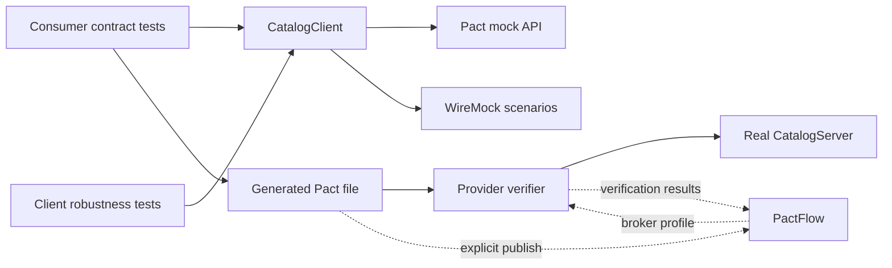

# API Contract Testing with Pact

Tests a fictional ecommerce API with Pact-JVM, verifies the real provider, and demonstrates PactFlow release compatibility alongside WireMock fault scenarios.

[](https://github.com/yashwant-das/qa-java-pact/actions/workflows/ci.yml)
[](https://github.com/yashwant-das/qa-java-pact/actions/workflows/codeql.yml)


## Why it exists

A passing test against a saved JSON response does not prove the API still returns that response. This project makes the difference observable:

- Consumer tests call the actual Java HTTP client and generate Pact contracts.
- Provider tests replay those contracts against a real, independent catalog API.
- A deliberate numeric-price-to-object change fails provider verification.
- WireMock fixtures exercise pagination, slow responses, service errors and incompatible payloads.
- Opt-in PactFlow commands publish contracts/results and check supported application versions.

All products and services are fictional. No Falabella code, data or infrastructure is used.

## Architecture



### Project structure

```text
consumer/       Real HTTP client, consumer Pact tests and WireMock robustness tests
provider/       Independent catalog API, functional tests and local/broker verification
wiremock/       File-based mappings and response bodies
mockoon/        Optional OpenAPI import exercise
scripts/        Guarded PactFlow commands and negative verification exercise
.github/        Credential-free CI and dependency updates
docs/           Architecture, development and learning guides
```

### Tech stack

| Layer | Tool | Version source |
| --- | --- | --- |
| Runtime | Java 21 | [.java-version](.java-version), compiler release in [pom.xml](pom.xml) |
| Build | Maven Wrapper | [.mvn/wrapper/maven-wrapper.properties](.mvn/wrapper/maven-wrapper.properties), distribution checksum pinned |
| Tests | JUnit 5, Pact-JVM | [pom.xml](pom.xml) |
| JSON | Jackson | [pom.xml](pom.xml) |
| Mocks | WireMock standalone | [compose.yaml](compose.yaml), same version in Maven tests |
| Quality | Spotless, PMD, pre-commit, markdownlint | [pom.xml](pom.xml), [.pre-commit-config.yaml](.pre-commit-config.yaml) |

## Quickstart

Prerequisites: JDK 21 and network access for the first dependency download. Set `JAVA_HOME` to JDK 21; confirm the Java runtime shown by `./mvnw -v`. Docker and PactFlow credentials are optional.

From the repository root:

```bash
./mvnw clean verify
```

Expected: `BUILD SUCCESS`, with 16 passing tests/invocations and no skipped tests. The consumer writes `consumer/target/pacts/StorefrontClient-CatalogApi.json`; the provider verifies its two interactions. No external API, PactFlow account or Docker daemon is used by this build.

The sample has one product per page: page 1 is a moisturiser, page 2 is sunscreen, and page 3 is empty.

## Usage

Run the mock API, then request a fixture:

```bash
docker compose up -d
curl 'http://localhost:8080/products?category=skincare&page=1'
docker compose down
```

Run the real sample API in a separate terminal:

```bash
./mvnw -pl consumer -am install -DskipTests
./mvnw -pl provider compile exec:java
```

It listens on `http://127.0.0.1:8081`. Stop it with Ctrl+C. See the [learning path](docs/learning-path.md) for pagination, errors, the breaking-change exercise, Mockoon and PactFlow.

## Verification

| Command | What it verifies |
| --- | --- |
| `./mvnw clean verify` | Actual consumer, local provider, WireMock mappings, Java formatting and PMD |
| `bash scripts/check-breaking-change.sh` | Provider verification rejects an object where the consumer requires a numeric price |
| `bash scripts/test-pactflow-guards.sh` | Cloud commands reject missing configuration before invoking account operations |
| `pre-commit run --all-files` | Maintained Markdown, Java formatting, YAML/JSON/XML and text hygiene |
| `bash scripts/pactflow.sh verify` | Live broker contracts against the local provider; explicitly publishes results |

The first three commands require no cloud account. Maven tests use loopback HTTP servers on random ports. The first Maven and hook runs download their pinned tools; subsequent runs can use cached dependencies. CI runs local verification and the negative exercise. Reports are under each module's `target/surefire-reports/`, with PMD results in `target/pmd.xml`.

PactFlow live operations and Mockoon desktop behaviour require separate setup; a local passing build does not prove either integration has run.

## Documentation

- [Architecture](docs/architecture.md): responsibilities, lifecycle and test boundaries.
- [Development](docs/development.md): setup, configuration, cloud commands, checks and limitations.
- [Learning path](docs/learning-path.md): step-by-step exercises and expected results.
- [Historical scope and plan](docs/superpowers/specs/2026-11-07-qa-java-pact-design.md): original design decisions, not current setup instructions.

## License

MIT. See [LICENSE](LICENSE).
