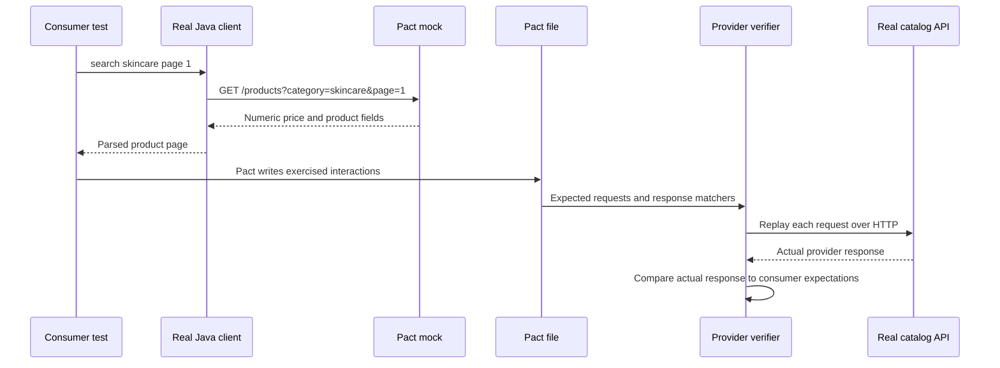

# Architecture

## Services and ownership

`StorefrontClient` is the Pact consumer name. Its real `CatalogClient` builds requests and decodes responses. `CatalogApi` is the provider name. Its `CatalogServer` uses the JDK HTTP server and an immutable fictional catalog; it imports no consumer code or DTOs.

Both services live in one repository for learning, but represent independently released applications. They use the namespace `com.qaframework.pact`. The provider's test-scope dependency on the consumer exists only to enforce Maven reactor order so the contract is generated before verification. It does not share schemas or models.

## Contract lifecycle

The consumer tests verify first-page parsing and exhausted pagination. Matchers permit different product names, IDs and numeric prices, while `currency` is constrained to CLP because this example's consumer uses that currency. Consumer assertions use the example values to prove actual parsing. Additional provider fields remain compatible.

Each provider interaction starts a new server on an ephemeral IPv4 loopback port and stops it afterward. The provider state `skincare products exist` describes an immutable catalog; the state callback performs no mutation. A stateful API would create/reset its own database fixtures there.

## Functional tests and resilience

`CatalogServerTest` checks distinct pages, pagination termination, unknown categories, bad parameters, duplicate parameters, methods and missing routes. Those are provider functional rules, separate from Pact's compatibility check.

`CatalogClientRobustnessTest` starts WireMock on a random port and loads exactly the mappings under `wiremock/`. It calls the same production client to check real parsing and error behaviour. Outages, malformed fields and timeouts are robustness inputs rather than provider promises. The default suite neither intercepts real traffic nor calls a third-party service.

Docker Compose runs WireMock's standalone distribution on port 8080 for manual exploration. The same files are used in automated tests. Mockoon's OpenAPI import is an optional, separately configured comparison; its responses do not feed provider verification.

## PactFlow boundary

Local verification reads generated files. The separate `broker` Maven profile reads contracts from PactFlow using main-branch and deployed/released consumer selectors. It checks the real local provider and publishes results only when enabled by the explicit script. Publishing verification results changes broker state.

The local build defaults result publishing to false. Broker credentials come from `PACT_BROKER_BASE_URL` and `PACT_BROKER_TOKEN`; they are never embedded in a POM, fixture, command argument or committed file. Publishing scripts require an immutable application version. A real organisation would build/version each service independently; this learning repository can use the same commit SHA for both.

Missing contracts are errors; neither local nor broker verification uses `@IgnoreNoPactsToVerify`. Do not add it to make an empty suite pass.

## Deliberate breaking change

`catalog.priceShape=object` replaces the provider's numeric `price` with an object containing amount and currency. It is a teaching switch; normal startup always uses the numeric format. The consumer contract stays unchanged, causing real provider verification to fail at the price field. No source edits or contract regeneration against the new shape are necessary.

## Trade-offs

The JDK server avoids making Spring knowledge a prerequisite. It is a local sample, without production authentication, persistence or deployment infrastructure. The client accepts only a server origin and positive page numbers, tolerates extra response fields, and rejects missing/wrongly typed fields. It returns HTTP failures and request timeouts to its caller; retry policy belongs to the application using it.

Contract checks cover exercised integration expectations. They do not prove stock calculations, payment rules, authorisation, performance or a complete shopping journey. Provider functional tests, security checks and end-to-end tests retain those responsibilities.
